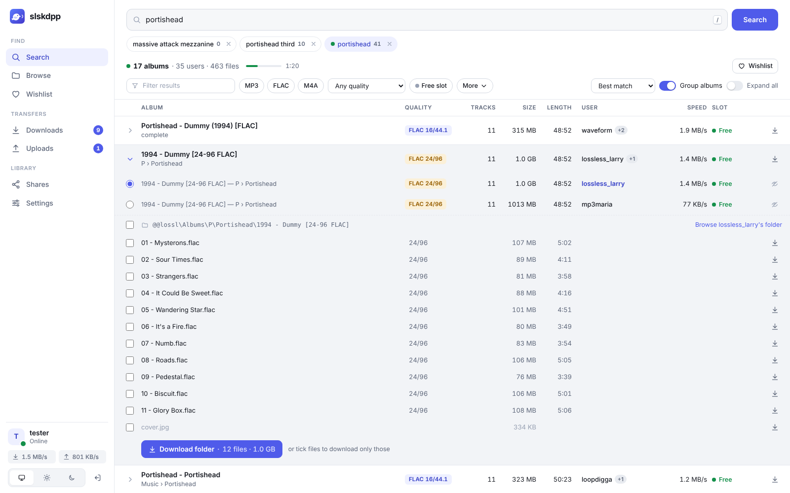
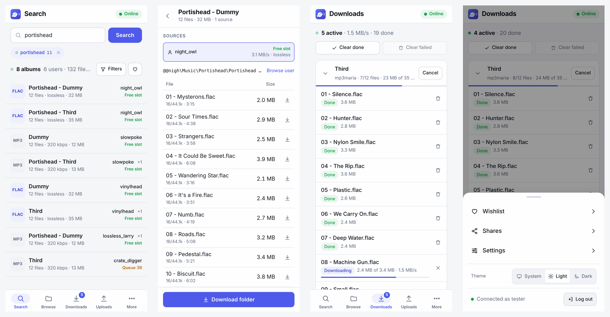
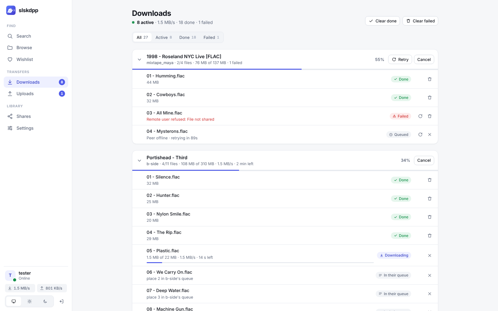
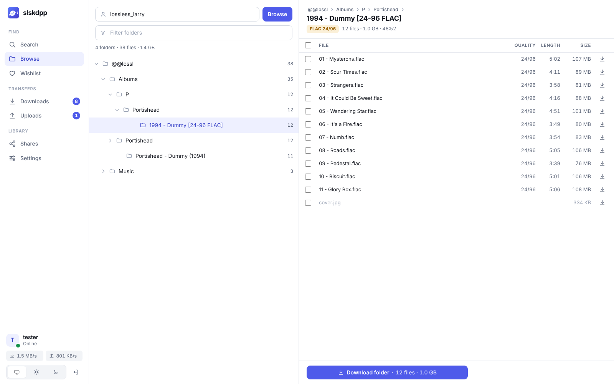

<p align="center">
  
</p>

<h1 align="center">slskdpp</h1>

<p align="center">
  <a href="https://github.com/kiesxoxo/slskdpp/actions/workflows/ci.yml"></a>
</p>

A small, headless [Soulseek](https://www.slsknet.org/) client with a web UI. It
is a single static binary of about 12 MB with the UI built in, and it idles at
around 30 MB of memory while sharing 100,000 files.

It does what you would expect from a Soulseek client, and focuses on four
things:

- **Light.** One static Go binary and SQLite on disk, with no runtime to install.
- **Better search.** Results stream in, grouped into albums across users and
  ranked so free slots, short queues and fast peers come first. You can filter
  by format, bitrate, slots and file count, and download a whole folder in one
  click.
- **Downloads that finish.** The queue survives restarts and partial files
  resume. Failures are retried with backoff. When a user refuses a file or stays
  offline, slskdpp searches for the same file elsewhere, and once it finds one
  file it moves the rest of the folder to the same user.
- **Automation.** There is a REST API with API keys, a wishlist that keeps
  searching and can download the best match, hooks and webhooks that run when
  downloads finish, and an slskd-compatible API so tools like
  [soularr](https://github.com/mrusse/soularr) work unchanged.

> **Status:** young. Every part is covered by tests, including CI runs of two
> full instances talking to each other through a test server, and it has been
> exercised against a simulated network. It has not had much time on the real
> Soulseek network yet, so expect rough edges and please report them.

<picture>
  <source media="(prefers-color-scheme: dark)" srcset="docs/screenshots/search-dark.png">
  
</picture>

## Contents

- [Quick start](#quick-start)
- [Configuration](#configuration)
- [The web UI](#the-web-ui)
- [Automation](#automation)
- [Using it with soularr and other slskd tools](#using-it-with-soularr-and-other-slskd-tools)
- [Networking](#networking)
- [Building from source](#building-from-source)

## Quick start

You need a Soulseek account (any username and password will do: the server
creates the account on first login).

### Docker

Images for amd64, arm64 and armv7 are published on GitHub's registry as
`ghcr.io/kiesxoxo/slskdpp`, tagged `latest`, by version (`0.1.0`) and by minor
version (`0.1`).

```bash
docker run -d --name slskdpp \
  -p 5030:5030 -p 2234:2234 \
  -v /srv/slskdpp:/data \
  -v /srv/music:/music:ro \
  -e SLSKDPP_USERNAME=me -e SLSKDPP_PASSWORD=secret \
  -e SLSKDPP_WEB_PASSWORD=changeme \
  ghcr.io/kiesxoxo/slskdpp:latest
```

Open <http://localhost:5030>, log in as `slskdpp` with your web password and add
`/music` under **Shares**. The container runs as UID 65532, so `/srv/slskdpp`
must be writable by it (`sudo chown 65532:65532 /srv/slskdpp`). Downloads land
in `/srv/slskdpp/downloads`.

For a config file, mount it at `/config/slskdpp.yaml`. The default image has no
shell, so [hook commands](#hooks) cannot run in it; webhooks still work. Use
the `-alpine` tags (such as `latest-alpine`) if you need commands.

With Compose:

```yaml
services:
  slskdpp:
    image: ghcr.io/kiesxoxo/slskdpp:latest
    restart: unless-stopped
    ports: ["5030:5030", "2234:2234"]
    volumes:
      - /srv/slskdpp:/data
      - /srv/music:/music:ro
    environment:
      SLSKDPP_USERNAME: me
      SLSKDPP_PASSWORD: secret
      SLSKDPP_WEB_PASSWORD: changeme
```

### Binary

Download the archive for your system from the
[releases page](https://github.com/kiesxoxo/slskdpp/releases) and unpack it. It
holds the binary, this README, an example config and, for Linux, a systemd
unit. Only the Linux builds have been tested so far. You can also
[build it yourself](#building-from-source).

```bash
cp slskdpp.example.yaml slskdpp.yaml   # set soulseek.username and password
```

```bash
./slskdpp -config slskdpp.yaml
```

To check your account before anything else:

```bash
./slskdpp -config slskdpp.yaml -check-login
```

### systemd

[`packaging/slskdpp.service`](packaging/slskdpp.service) is a hardened unit;
the comments at its top show how to install it. It keeps its state and
downloads in `/var/lib/slskdpp` and reads its config from
`/etc/slskdpp/slskdpp.yaml`.

## Configuration

Everything lives in one YAML file. See
[`slskdpp.example.yaml`](slskdpp.example.yaml) for every option with comments.
A missing file is fine, because every setting has a default or an environment
variable:

| Variable | Setting |
|---|---|
| `SLSKDPP_USERNAME`, `SLSKDPP_PASSWORD` | Soulseek account |
| `SLSKDPP_SERVER` | Soulseek server (default `server.slsknet.org:2242`) |
| `SLSKDPP_LISTEN_PORT` | port other users connect to (default 2234) |
| `SLSKDPP_DATA_DIR` | database and state (default `data`) |
| `SLSKDPP_DOWNLOADS_DIR`, `SLSKDPP_INCOMPLETE_DIR` | default `<data>/downloads`, `<data>/incomplete` |
| `SLSKDPP_WEB_LISTEN` | web UI address (default `:5030`) |
| `SLSKDPP_WEB_USERNAME`, `SLSKDPP_WEB_PASSWORD` | web login (default user `slskdpp`) |
| `SLSKDPP_API_KEY` | an API key for scripts |
| `SLSKDPP_WEB_TRUSTED_PROXIES` | reverse proxies, comma-separated; see [Networking](#networking) |
| `SLSKDPP_LOG_LEVEL` | `debug`, `info`, `warn` or `error` |

If `web.password` is empty, slskdpp makes up a password at startup and prints
it in the log.

Shares can be listed in the config as `"/path"` or `"Name=/path"` (`Name` is
what other users see), or added and removed on the **Shares** page. Hidden
files are never shared. Changes on disk are picked up as they happen.

## The web UI

- **Search.** Results arrive live and are grouped into albums, with format,
  bitrate (or bit depth and sample rate for lossless files), size and length.
  You can filter, open an album to see each user's copy, download a folder or
  a single file, browse the user, or put the search on the wishlist.
- **Browse.** A user's whole share as a folder tree you can filter.
- **Downloads.** Progress grouped by folder, place in the uploader's queue,
  retry countdowns, and which source is being tried. Files can be cancelled,
  retried or cleared.
- **Uploads.** Who is downloading from you, the queue in order, and slots in
  use.
- **Wishlist.** Saved searches that keep running; see [below](#wishlist).
- **Shares.** Folders you share, their totals, and rescans.
- **Settings.** API keys, hooks with a test button, and account
  status.

It works on phones too. The theme follows your system, or you can pick light or
dark in the sidebar (under **More** on phones).

<picture>
  <source media="(prefers-color-scheme: dark)" srcset="docs/screenshots/phone-dark.png">
  
</picture>

<table>
  <tr>
    <td><picture>
      <source media="(prefers-color-scheme: dark)" srcset="docs/screenshots/downloads-dark.png">
      
    </picture></td>
    <td><picture>
      <source media="(prefers-color-scheme: dark)" srcset="docs/screenshots/browse-dark.png">
      
    </picture></td>
  </tr>
</table>

## Automation

### API and API keys

Everything the UI does goes through a JSON API under `/api/v1`, with live
updates as server-sent events at `/api/v1/events`. Scripts authenticate with an
API key in an `X-API-Key` header or as `Authorization: Bearer <key>`. Create
keys under **Settings**, where the key is shown once, or set them in
`web.api_keys` or `SLSKDPP_API_KEY`. Keys can do everything except manage other
keys.

```bash
curl -H "X-API-Key: $KEY" -H 'Content-Type: application/json' \
  -d '{"query": "aphex twin drukqs"}' http://localhost:5030/api/v1/searches
```

The main endpoints are:

| | |
|---|---|
| `POST /api/v1/searches`, `GET …/{id}/albums` | search, and the deduplicated, ranked albums (filters as query parameters: `formats`, `min_bitrate`, `free_slot_only`, `min_files`, `exclude_users`) |
| `GET /api/v1/users/{user}/browse`, `…/folder?path=` | browse a user, or list one folder |
| `POST /api/v1/downloads/folder` | `{"username", "folder"}`: download a whole folder |
| `POST /api/v1/downloads` | `{"username", "files": [{"path", "size"}]}` |
| `GET /api/v1/downloads`, `POST …/{id}/cancel`, `…/{id}/retry` | the download queue |
| `GET /api/v1/uploads`, `/api/v1/shares`, `/api/v1/wishlist` | the rest of the UI |

### Wishlist

Wishlist entries are searched one at a time, as often as the Soulseek server
allows (it tells clients the interval, usually 12 minutes for accounts without
privileges). Each entry has a query and optional filters. With **download the
best match** on, the first time an album passes the filters slskdpp fetches the
whole folder from the best source and marks the entry done.

### Hooks

When a download finishes, slskdpp can run a command, call a webhook, or both:

```yaml
hooks:
  on_download: ""                                 # after each file
  on_folder: 'beet import -q "$SLSKDPP_PATH"'     # after each folder
  webhook: "https://example.com/slskdpp"          # both, as JSON POSTs
```

Commands run with `sh -c`, one at a time and in order, so a folder's hook
always comes after the hooks for its files. They get these variables:

| Variable | |
|---|---|
| `SLSKDPP_EVENT` | `download.completed` or `folder.completed` |
| `SLSKDPP_PATH` | the local file, or the folder |
| `SLSKDPP_FOLDER` | the local folder |
| `SLSKDPP_USERNAME` | who it came from (comma-separated for folders) |
| `SLSKDPP_REMOTE_PATH` | the file's path on the user's side |
| `SLSKDPP_SIZE` | bytes |
| `SLSKDPP_FILES`, `SLSKDPP_FAILED` | for folders: files completed and failed |

The webhook gets the same fields as JSON (`event`, `path`, `folder`,
`username`, `filename`, `size`, `files`, `failed`, `time`) and is retried a few
times if it fails. **Settings → Send a test event** runs each hook once and
shows you its output.

## Using it with soularr and other slskd tools

slskdpp answers the parts of [slskd](https://github.com/slskd/slskd)'s API that
tools built on it use: searches, search responses, user directories and
browsing, download transfers, and application version and options. These live
under `/api/v0` with slskd's field names and states.

For soularr, set the `[Slskd]` section as you would for slskd:

```ini
[Slskd]
api_key = <an slskdpp API key>
host_url = http://slskdpp:5030
url_base = /
download_dir = /path/to/slskdpp/downloads
```

`download_dir` must be slskdpp's downloads folder as soularr sees it. Files land
in `<downloads>/<remote folder name>/<file>`, which is where soularr looks.

Only API key authentication is supported, not slskd's username and password
sessions. Chat, rooms and slskd's other endpoints are not implemented.

## Networking

Forward the Soulseek listen port (TCP 2234 by default) to the machine running
slskdpp. Without it, other users can still reach you, but only through
"firewall piercing", and two firewalled users cannot connect at all.

slskdpp joins the distributed search network as a leaf. It receives other
users' searches through a parent and answers them from your shares, but passes
nothing on.

For browser access from outside your network, put the web UI behind a reverse
proxy with HTTPS. Session cookies switch to `Secure` when the proxy sends
`X-Forwarded-Proto: https`. Server-sent events need buffering off; slskdpp
sends `X-Accel-Buffering: no` for nginx.

After 5 failed logins from one address, logins from it are refused for a while.
Behind a proxy every request seems to come from the proxy, so tell slskdpp
which proxies to believe about the real client address. A proxy on the same
machine is trusted already. For one elsewhere, such as in another Docker
container, list it:

```yaml
web:
  trusted_proxies: ["172.16.0.0/12"]   # IPs or CIDR ranges
```

Other users' clients are untrusted too. slskdpp limits incoming peer
connections (1024 in total, 32 per address), drops browse, folder and user info
responses it did not ask for without reading them, and caps how large any
message may be, by type. It decodes only a few large messages at a time.

## Building from source

You need Go 1.26.10 or newer (older Go fetches it automatically) and Node.js 22.

```bash
make build      # web UI (npm) and the static binary in bin/slskdpp
```

```bash
make test       # go test -race ./...
```

```bash
make ui-check   # svelte-check on the UI
```

To work on the UI, run `npm run dev` in `web/` while slskdpp runs on port 5030;
Vite proxies `/api` to it.

`make build-go` builds without rebuilding the UI. Without a built UI the binary
serves a short "UI not built" page, and the API still works.

`slskdpp -version` prints the version the binary was built from.

To release, add a section for the version to [CHANGELOG.md](CHANGELOG.md) and
push a tag such as `v0.2.0`. The release workflow runs CI, then publishes the
binaries, checksums and changelog section as a GitHub release, and the images
on ghcr.io. A tag with a hyphen (`v0.2.0-rc.1`) makes a pre-release and leaves
`latest` alone.

The code is organized as follows:

| | |
|---|---|
| `internal/protocol` | the Soulseek wire format |
| `internal/client` | server session, peer connections, the distributed network |
| `internal/search` | searches, grouping into albums, ranking |
| `internal/transfers` | downloads (queue, resume, retries, other sources) and uploads |
| `internal/shares` | share index (SQLite FTS5), scanning, the share list |
| `internal/audio` | bitrate, length and quality from audio file headers |
| `internal/wishlist`, `internal/hooks` | automation |
| `internal/api` | REST API, events, auth, the slskd-compatible API |
| `internal/app` | wires it all together |
| `web/` | the Svelte UI |
